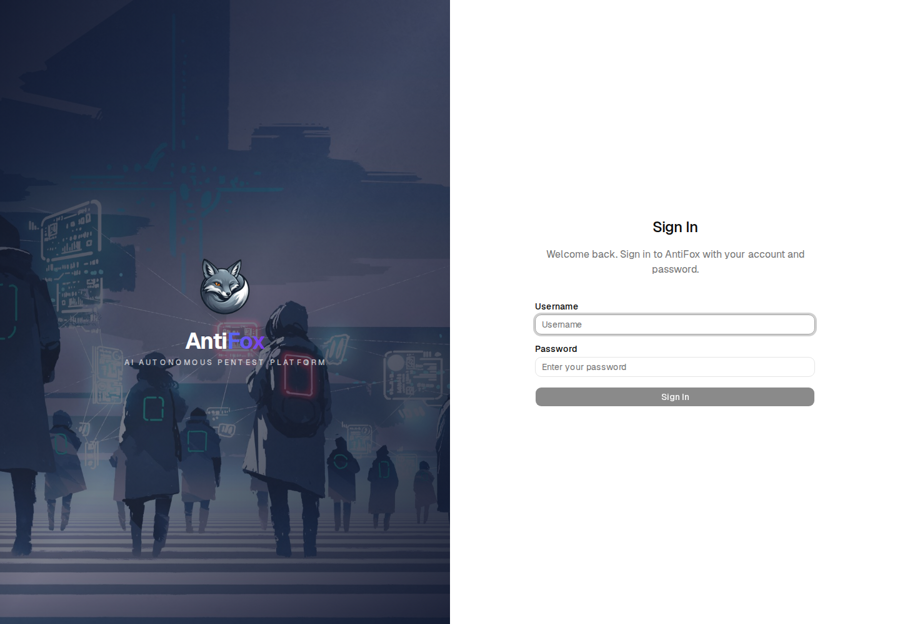
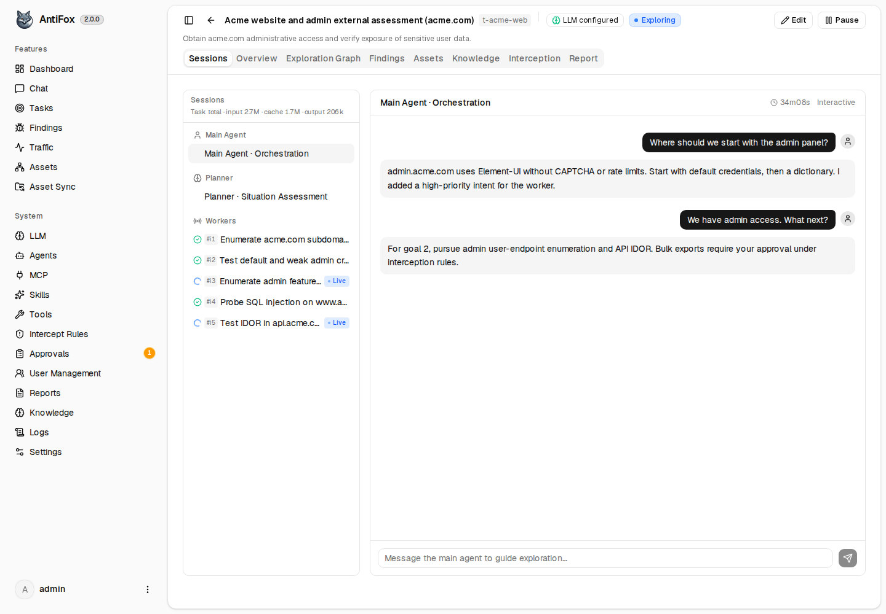
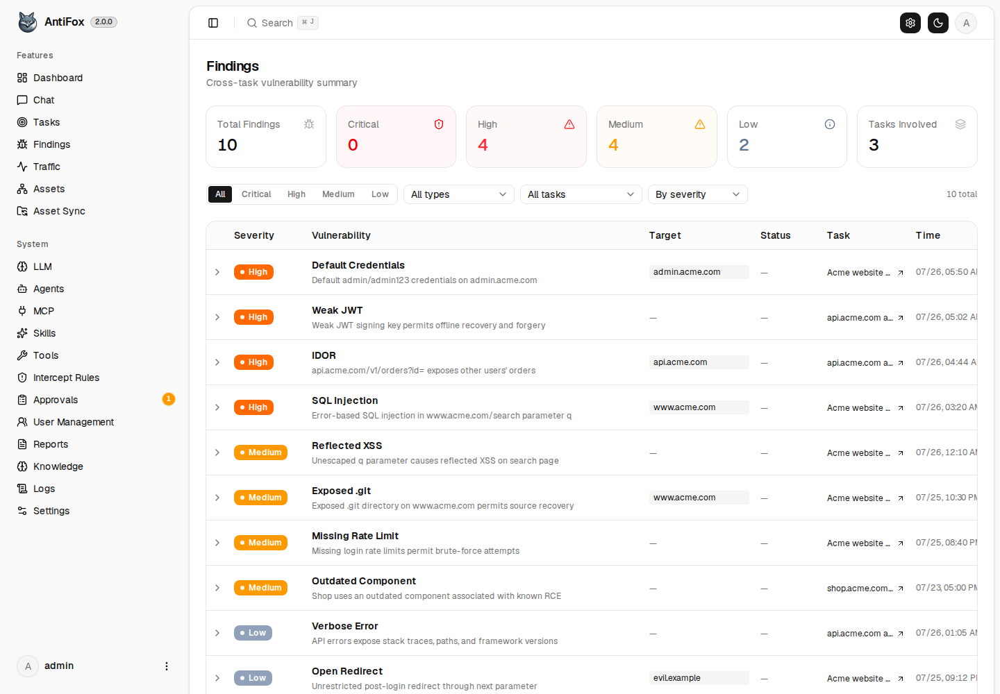
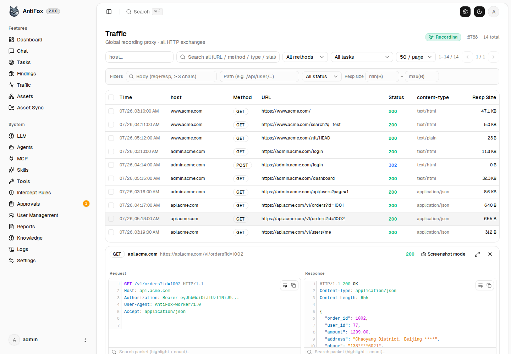
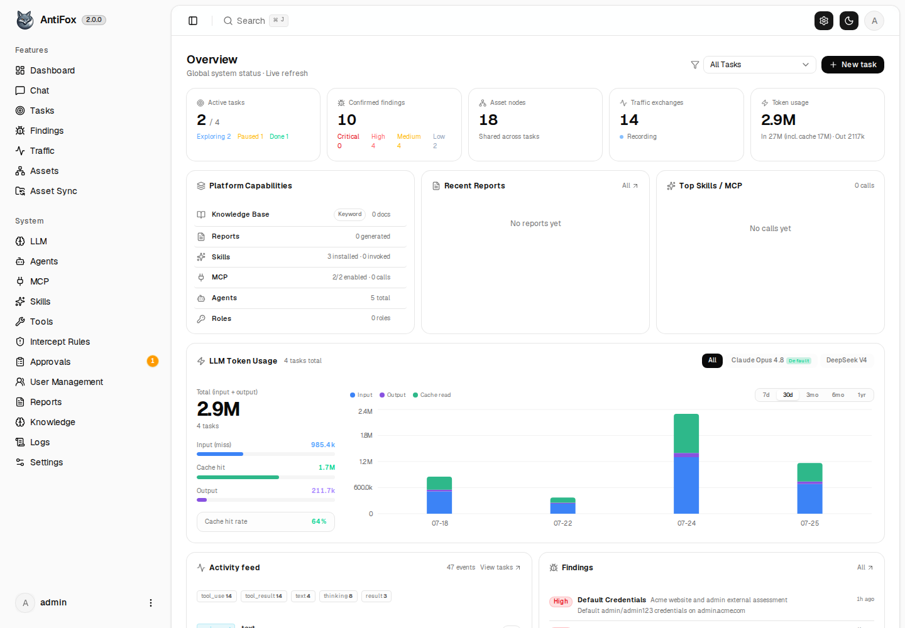
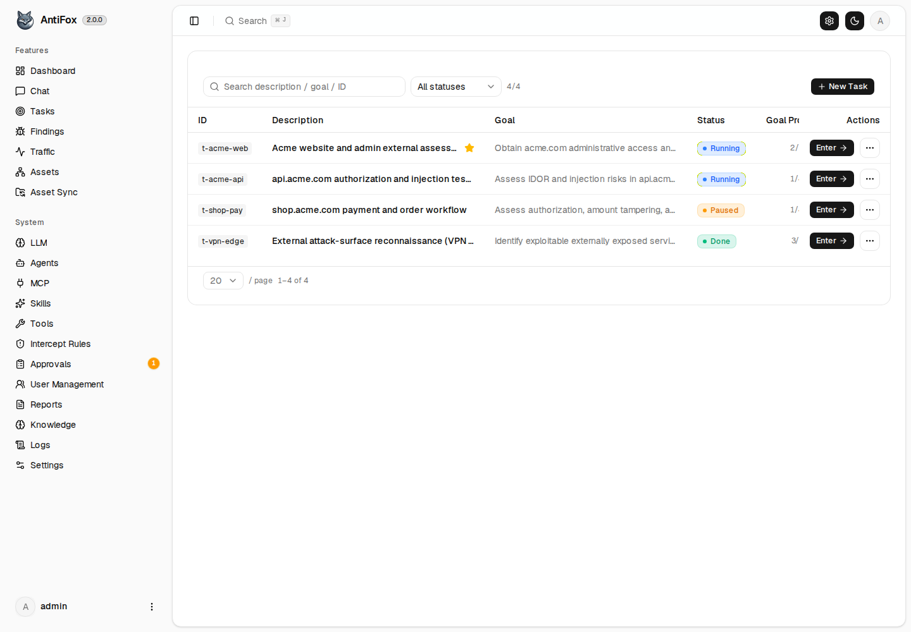
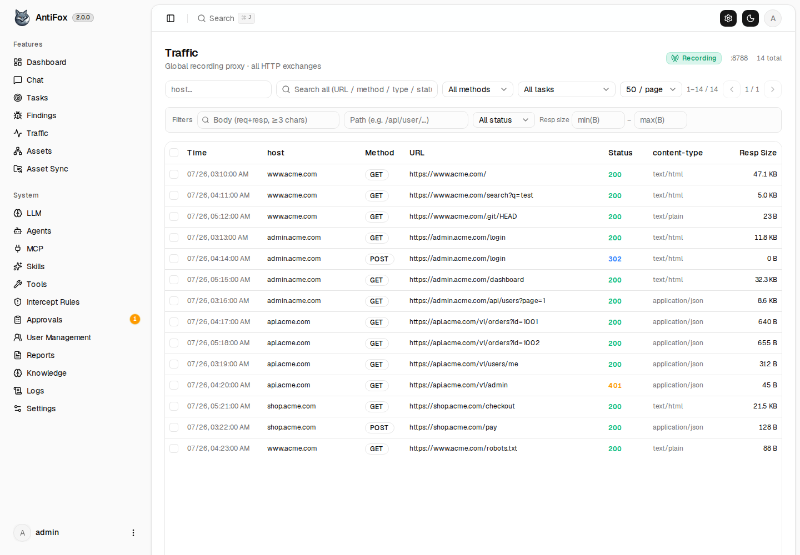
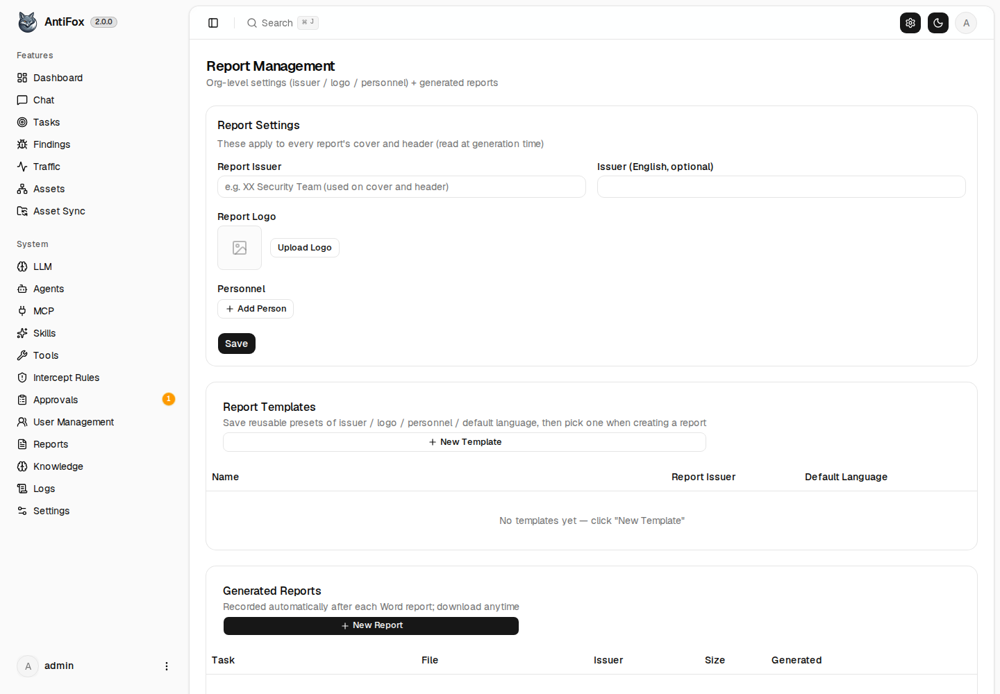
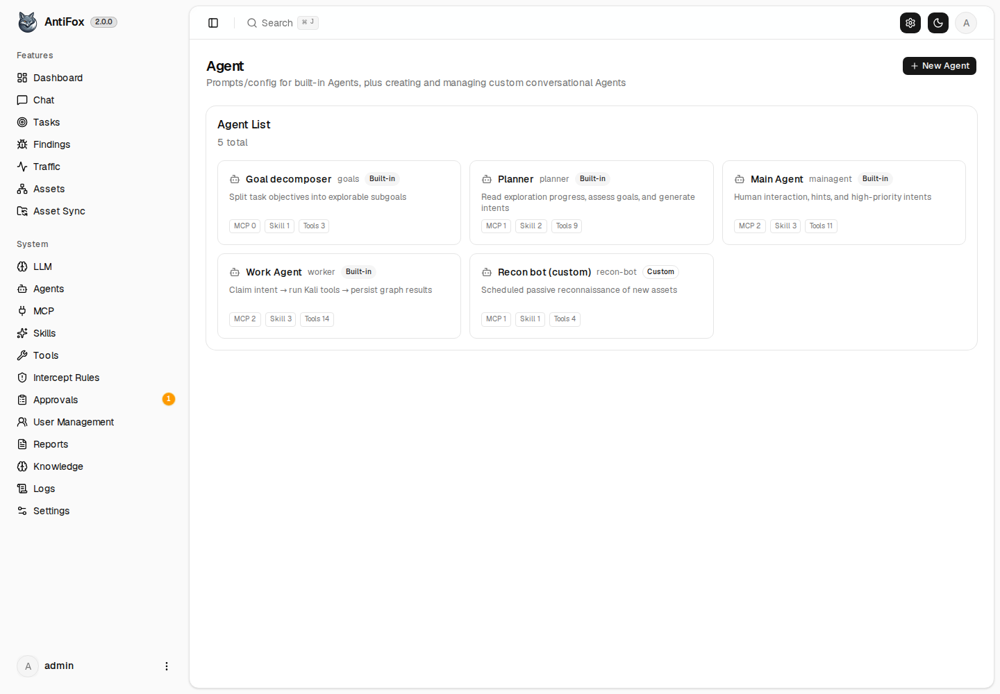
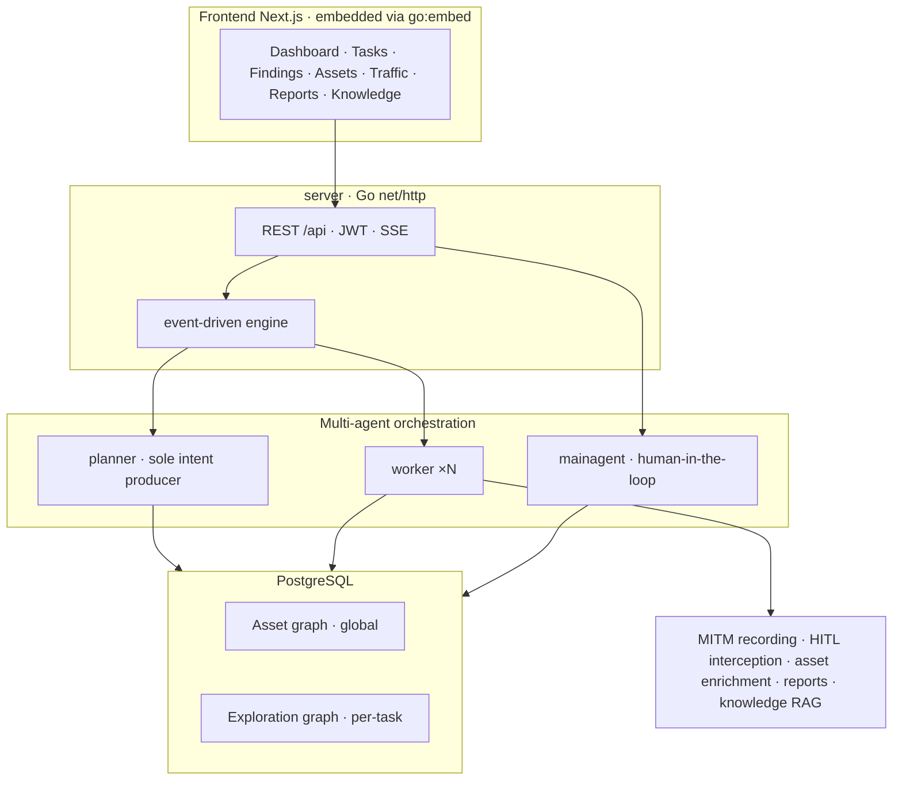

<div align="center">

# 🦊 AntiFox

**AI-Driven Autonomous Penetration Testing Platform**

From recon to report delivery — multi-agent, autonomous · fully observable · interactive · deliverable

[Documentation](README.md) | [Changelog](CHANGELOG.md) | [Contributing](CONTRIBUTING.md)

[](LICENSE)
[](https://github.com/benisprlh/antifox_fork)
[](go.mod)



</div>

---

## About This Fork

This repository, [benisprlh/antifox_fork](https://github.com/benisprlh/antifox_fork), is a fork of [AntiFox-AI/antifox](https://github.com/AntiFox-AI/antifox) with an English UI, documentation, built-in agent prompts, backend messages, demo data, and reports. Source history, original credits, and the AGPL-3.0 license are retained.

Build this fork from source or use the Docker build below to run the English version. The updater checks this fork's releases; no upstream binary is installed automatically. Legacy saved language selections resolve to English. Existing user-created content and captured evidence remain verbatim; saved prompts can be reset to the English built-in defaults in Agent settings.

## Overview

AntiFox is an AI-driven autonomous penetration testing platform. Given an authorized target, a planner / worker / main-agent multi-agent system runs the full engagement over a **dual-graph** core (a global asset graph + a per-task exploration graph) — **recon → attack-surface discovery → exploitation → finding capture → report delivery** — fully observable, interactive, and deliverable.

Unlike most automated pentest tools that are "great at discovery, but stop at discovery," AntiFox puts its weight on **delivery** — turning what the AI finds into a report that an engineer can understand, reproduce, back with evidence, and hand straight to the client.

## ✨ What's New in v2.0: Evidence-Driven Delivery

v2.0 is about one thing — **turning "can find it" into "can deliver it."** The agent fixes the reproduction steps and evidence in place while it works, so the engineer's job shifts from "assembling a report from scratch" to "verify and confirm."

<div align="center">

</div>

**① Reproduction captured in place.** As the agent exploits, each step's request, response, expected outcome, and verification conclusion are recorded as structured data — not reconstructed after the fact — eliminating the old "incomplete or fabricated reproduction" problem.

**② Findings laid out as a kill chain.** A finding is no longer "one command plus a verdict," but a full chain from entry point and preconditions through each exploitation step, each in plain language paired with a real request — so an engineer opening the finding immediately grasps where it came from and how it was chained.

<div align="center">

</div>

**③ Every step auto-linked to its real traffic.** Enable **Traffic capture** in System Settings to record requests routed through the MITM proxy; capture is off by default. When a finding is recorded, the system links each step to its corresponding real packet by time window and step order. One click shows the original request/response, with syntax highlighting, body search, and match counts — no need to go back to a proxy tool and reconstruct it.

<div align="center">

</div>

**④ The packet is the evidence.** For findings like sensitive-information disclosure, the traffic packet itself is the proof — no more stitching together screenshots afterwards.

**⑤ English reports.** AI narrative + python-docx rendered into a delivery-grade `.docx` (cover / TOC / page numbers / per-vuln tables with structured reproduction), with English headings, narrative, and fallback content.

> All UI data shown is synthetic demo data from a local test range.

## Quick Start

Requires **PostgreSQL**; exploration needs an **LLM** (`ANTHROPIC_API_KEY` or `OPENAI_API_KEY`, or configure it in the UI). Generating `.docx` reports needs `python3` + `python-docx` (bundled in the Docker image).

### Option 1: Docker build (recommended)

```bash
git clone https://github.com/benisprlh/antifox_fork.git
cd antifox_fork
cp .env.example .env          # set POSTGRES_PASSWORD
docker compose up -d --build  # builds this fork and starts PostgreSQL
```

Open **http://localhost:8787** — on first run, go to `/setup` to set the admin password.

### Option 2: Build from source

The **full source is open** (AGPL-3.0). Requires Go 1.26.3+ / Node 22+ / PostgreSQL / Python 3 (report rendering):

```bash
git clone https://github.com/benisprlh/antifox_fork.git
cd antifox_fork
cd web && npm ci && npm run build:static && cd ..
mkdir -p server/webui/dist server/skillsdist
cp -r web/out/. server/webui/dist/
cp -r skills/. server/skillsdist/
rm -rf server/skillsdist/report-generation         # generated by Go
cp config.example.json config.json                # configure PostgreSQL
CGO_ENABLED=0 go build -tags embedui -o antifox ./cmd/antifox
./antifox
```

Full steps (skill embedding, dev hot-reload) are in [CONTRIBUTING.md](CONTRIBUTING.md).

> **One-click update:** for a binary/source deploy, launch via `./start.sh` or systemd (see [`deploy/antifox.service`](deploy/antifox.service), set `RestartForceExitStatus=75`) to check for and install new versions from **System Settings** (SHA256 verify / atomic swap / rollback; data unaffected). Updates are available only after releases are published in this fork. Development builds use the source build workflow. For Docker, pull the latest source and run `docker compose up -d --build`.

### Run and review a task

1. Configure an LLM profile in **System Settings**, then create a task with a target, explicit scope, and a measurable goal. A task pinned to a profile uses that profile's model.
2. Enable **Traffic capture** before starting if you need saved HTTP exchanges. Changes apply to subsequent agent runs; an already-running worker retains its current settings until its next run.
3. Follow the planner and workers in the task's **Sessions** tab. **Idle** means no worker is executing; check the task status and goal progress. **Done** means the goals were met. **Failed** may include a provider refusal; read the session error and review the request and provider policies before retrying.
4. Review findings against their actual request/response evidence. Mark unsupported findings **False positive**; these are excluded from generated reports. Generate and download the English report after review.

The Docker image uses its bundled Chromium for the browser MCP. Source installations must provide a compatible browser executable through `PLAYWRIGHT_MCP_EXECUTABLE_PATH` or the MCP `--executable-path` option.

## More Screens

| Dashboard | Tasks |
| :---: | :---: |
|  |  |

| Traffic | Reports |
| :---: | :---: |
|  |  |

| Agents |
| :---: |
|  |

## Lineage

AntiFox is a fork that started from **v0.1.1** of the open-source project ARTEX (by [@Autumn-27](https://github.com/Autumn-27)), tracking upstream ever since, with mutual exchange along the way. Full credit to the original author's foundational work.

To be clear, "autonomous discovery" and "report delivery" are two different goals: ARTEX made discovery strong, while delivery is closer to each specific engagement and varies by client. AntiFox builds on that solid foundation and invests its engineering effort in the "delivery" half.

## What AntiFox Adds (vs ARTEX)

Building on its solid foundation (exploration-graph engine, MITM traffic recording, rule-based HITL interception, multi-agent orchestration), AntiFox mainly adds:

| Area | Details |
| --- | --- |
| **Evidence-driven delivery** | Reproduction captured in place, findings laid out as a kill chain, every step auto-linked to its real packet (syntax highlight / body search / match counts) |
| **Human-grade reports** | AI narrative + python-docx into delivery-grade .docx (cover / TOC / page numbers / per-vuln tables), English report content |
| Report management | Org settings, named templates (issuer / logo / personnel / CVSS), per-task generation, select which findings to include |
| Deeper vuln management | AI enrichment into structured data (CVSS / impact / fix / structured reproduction), 4 severity levels, batch enrichment, session finding capture |
| English interface | English UI, backend messages, built-in prompts, and demo data |
| Multi-user RBAC | Visual permission-matrix custom roles, system roles, resource-level scope, login audit |
| Knowledge-base RAG | Global + per-task two-tier pgvector retrieval augmentation for agents |
| One-click update | Check for and install a new version from GitHub Releases (SHA256 verify / atomic swap / auto-rollback) right from System Settings — your data is untouched |

## Architecture

A single Go backend (Next.js frontend embedded via `go:embed`) + PostgreSQL. The core is a **dual-graph** design: a globally shared asset graph (cross-task source of truth) and a per-task exploration graph (goal / intent / fact / finding lineage), linked by anchors. The engine is event-driven — any graph change wakes the planner to dispatch intents, workers execute and write back, which triggers the next round, until the goal is proven.



## Core Capabilities

- Dual-graph: global asset graph + per-task exploration graph, linked by anchors
- Multi-agent orchestration: event-driven engine, planner produces intents / N workers execute / mainagent is the human interface
- Evidence-driven delivery: reproduction captured in place, findings as a kill chain, every step linked to its real packet
- English reports: AI narrative + python-docx delivery-grade .docx
- MITM traffic recording, rule-based HITL interception, MCP / Skill extension system, pgvector knowledge base

## Upstream Community

Project news and community links are available in the [upstream repository](https://github.com/AntiFox-AI/antifox).

## Credits

- [AntiFox-AI/antifox](https://github.com/AntiFox-AI/antifox) — the upstream AntiFox project.
- ARTEX (by [@Autumn-27](https://github.com/Autumn-27)) — the technical foundation of this project.

## License & Disclaimer

Licensed under **AGPL-3.0** — see [LICENSE](LICENSE). Use, modification, and redistribution (including offering it as a networked service) must comply with its terms.

**AntiFox is for personal study, code research, and local technical validation only. It must not be used to perform actual testing against any online system or website.**

### Permitted use

- Reading, studying, and researching this project, and verifying technical principles in a local, isolated environment;
- Personal learning, academic research, and other non-offensive purposes.

### Prohibited

- Using this tool to scan, probe, exploit, or attack any website, online service, or networked system;
- Using this tool for any real penetration testing, red/blue exercises, or production environment;
- Using it for intrusion, data theft, ransom, denial of service, or any destructive or criminal activity;
- Using it for anything violating the laws and regulations of your country / region.

### Compliance
Users must comply with all applicable laws and regulations on cybersecurity, data protection, and computer crime in their country / region. All legal responsibility and consequences arising from use of this project rest solely with the user.

### Disclaimer
This project is provided "AS IS", without warranty of any kind. The authors and contributors are not liable for any direct or indirect loss, data loss, system damage, or legal dispute arising from use of this tool. By downloading, installing, or using this project, you acknowledge that you have read, understood, and agree to all of the above.
