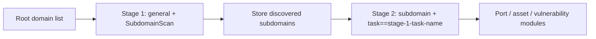

---

## name: scopesentry-mcp
description: Manage the security scanning platform through ScopeSentry MCP (projects, tasks, templates, assets, nodes). Use when users mention ScopeSentry, MCP, API keys, scan tasks, or asset queries.

# ScopeSentry MCP Guide

For users with an **existing ScopeSentry deployment**. Connect through Cursor or another MCP client; local source code is not required.

## 1. Preparation

### 1.1 Verify Service Access

- Default web interface: `http://<host>`
- MCP endpoint: `http://<host>/mcp` (use the actual `/mcp` address if a reverse or frontend proxy is present)

### 1.2 Create an API Key

1. Sign in to the ScopeSentry web interface
2. Create a key on the **API Key** management page or through an administrator-provided endpoint
3. Save the returned `ssk_...` string (**shown only once**)

### 1.3 Configure Cursor MCP

Cursor → Settings → MCP → Add server:

```json
{
  "mcpServers": {
    "scopesentry": {
      "url": "http://<your-host>:8082/mcp",
      "headers": {
        "X-API-Key": "ssk_your_key"
      }
    }
  }
}
```

Alternatively, use `Authorization: Bearer ssk_your_key`.

Restart MCP or reload Cursor, then confirm that tools such as `list_projects` and `list_assets` appear.

---

## 2. Tool Overview


| Tool | Purpose |
| ---------------------- | ----------------- |
| `list_projects` | Project tree grouped by tags, including project IDs |
| `list_projects_data` | Paginated project list, searchable by name |
| `get_project` | Project details |
| `create_project` | Create a project |
| `list_tasks` | List scan tasks |
| `get_task` | Task details |
| `list_scan_templates` | List scan templates |
| `get_scan_template` | Template details |
| `list_plugin_modules` | Scan pipeline module names |
| `list_plugins` | Available plugins, including hashes and default parameters |
| `create_scan_template` | Create a scan template |
| `create_scan_task` | Create a scan task |
| `list_assets` | Query asset types with pagination |
| `count_assets` | Count assets (`/api/assets/common/total`) |
| `get_asset_detail` | Asset or vulnerability details |
| `add_asset_tag` | Add asset tags |
| `list_nodes` | List scan nodes |


The MCP tool descriptions (schemas) define tool parameters. `list_assets` and `count_assets` share search/filter syntax; read the `list_assets` description before querying.

Use `count_assets` for total counts (the same endpoint used by web pagination), instead of paging through `list_assets` just to count results.

---

## 3. Common Workflows

### 3.1 Query Assets by Project

When the user or context **already identifies a project**, prefer `filter.project` to narrow the query and avoid slow cross-project responses. A project filter is optional when no project is specified.

1. Get the project's **ObjectID** (`id` / `children[].value`) with `list_projects` or `list_projects_data`
2. Pass `filter.project` to `list_assets` (**use the ID, not the project's display name**)

```json
{
  "asset_type": "asset",
  "pageIndex": 1,
  "pageSize": 20,
  "search": "domain=^example.com",
  "filter": {
    "project": ["<projectObjectID>"]
  }
}
```

### 3.2 Create a Scan Task

1. Get online node names with `list_nodes`
2. Get a template **ObjectID** with `list_scan_templates` or `create_scan_template`
3. Call `create_scan_task`: `name` and `node` are required; `template` must be a template ID, not its name

**Target source `targetSource` (same as the web interface):**

| targetSource | Description | Required Parameters |
| --- | --- | --- |
| `general` | Direct target input | `target` |
| `project` | Read targets from projects | `project` (array of project ObjectIDs) |
| `asset` | Search the web asset inventory | `search`; optional `project`, `filter`, `targetNumber` |
| `RootDomain` | Search root domains | `search`; optional `project`, `filter`, `targetNumber` |
| `subdomain` | Search subdomains | `search`; optional `project`, `filter`, `targetNumber` |
| `UrlScan` | Search URL scan results | `search`; optional `project`, `filter`, `targetNumber` |
| `*Source` (such as `subdomainSource`) | Create from selected/searched assets | Use `search` for `targetTp=search`, or `targetIds` for `targetTp=select` |

**Example: Scan root domains directly:**

```json
{
  "name": "example-subdomain-discovery",
  "node": ["node-1"],
  "template": "<templateObjectID>",
  "targetSource": "general",
  "target": "example.com\nfoo.com",
  "project": ["<projectObjectID>"]
}
```

**Example: Continue scanning discovered subdomains, filtered by the previous task's name:**

```json
{
  "name": "example-ports-and-vulnerabilities",
  "node": ["node-1"],
  "template": "<followupTemplateObjectID>",
  "targetSource": "subdomain",
  "search": "task==\"example-subdomain-discovery\"",
  "project": ["<projectObjectID>"]
}
```

### 3.3 Complete Root Domain Reconnaissance (Two Stages Recommended)

For **root domain** inputs requiring **complete reconnaissance**, use two scans instead of running the whole pipeline at once.

**Reason:** Distributed work is assigned by **individual target**. When a node receives a root domain, the subdomains it discovers also run subsequent modules on that same node, potentially causing uneven load, slow execution, and errors.

**Best practice:**

1. **Stage 1: Subdomain discovery only**
   - `targetSource`: `general`
   - `target`: All root domains, one per line
   - Template: Enable only `SubdomainScan` and `SubdomainSecurity` (subdomain discovery and takeover checks)
   - Wait for completion using `get_task`

2. **Stage 2: Subsequent modules**
   - `targetSource`: `subdomain`
   - `search`: `task=="<stage-1-task-name>"` (exact task-name match)
   - Optionally use `project` to narrow the scope
   - Template: Port scanning, asset mapping, vulnerability scanning, etc.; SubdomainScan may be omitted
   - Distribute subdomains as independent targets across nodes for better parallelism

The equivalent web workflow is to filter the Subdomains asset page by task name, then choose "Create task from subdomains".



### 3.4 Create a Scan Template

1. `list_plugin_modules` → module names
2. `list_plugins`, optionally filtered by `module` → each plugin's `hash` and default `parameter`
3. `create_scan_template`: Use `modules` to map each module to an array of plugin hashes

---

## 4. Asset Queries (`list_assets` / `count_assets`)

`count_assets` and `list_assets` accept the same `asset_type`, `search`, and `filter`. `count_assets` returns `{ "total": N }`, matching the web endpoint `/api/assets/common/total`.

```json
{
  "asset_type": "subdomain",
  "search": "task==\"task-name\"",
  "filter": {"project": ["<projectObjectID>"]}
}
```

**Performance guidance for both tools:** Prefer `filter.project` when a project is known. For indexed fields in `search`, use exact `==` or prefix `^` matching (see [4.3](#43-search-expressions)); broad `=` regex queries can be slow. Project filtering is optional without project context.

See [4.4](#44-exact-filtering) for asset types supporting `filter.project`.

### 4.1 Asset Types (`asset_type`)

`asset`、`RootDomain`、`subdomain`、`app`、`mp`、`UrlScan`、`SensitiveResult`、`DirScanResult`、`crawler`、`vulnerability`、`PageMonitoring`、`IPAsset`、`SubdomainTakerResult`

Example aliases: `web` → asset, `vuln` → vulnerability, `ip` → IPAsset, `url` → UrlScan

### 4.2 Parameters


| Parameter | Description |
| ------------------------ | --------------------------------------- |
| `pageIndex` / `pageSize` | Pagination; defaults to 1 / 20 |
| `search` | Search expression (see below) |
| `filter` | Exact-match filter JSON (see below) |
| `sort` | Sort by `length`; only supported by UrlScan and DirScanResult |
| `sid` | Sensitive rule name; SensitiveResult only |


`search` and `filter` **can be combined**.

### 4.3 Search Expressions

Custom DSL (**not SQL**):


| Operator | Meaning | Index Use | Example |
| ---- | ---- | ---- | --------------------------- |
| `=` | Partial match (regex) | No | `domain=example` |
| `==` | Exact equality | **Yes** | `port==443` |
| `!=` | Exclude | — | `port!="80"` |
| `&&` | AND | — | `domain==example.com && port==443` |
| `\|\|` | OR | — | `title=admin \|\| body=login` |


**Indexes and operators:** Fields such as `domain`, `ip`, `port`, and `title` are indexed, but only **exact `==`** or **prefix matches starting with `^`** (such as `domain=^example.com`) use indexes. **Unanchored `=` becomes a regex partial match and cannot use the index**, which can be slow on large datasets.

**Search fields shared by all types:** `tag`, `task` (task name), `rootDomain`

**Do not put project in search**; it is ineffective or causes errors when combined with `&&`. Use `filter.project` instead.

**Common search fields by type:**


| asset_type | Fields |
| -------------------- | ----------------------------------------------------------------------------------- |
| asset                | domain, ip, port, service, app, title, statuscode, icon, banner, type, body, header |
| RootDomain           | domain, icp, company                                                                |
| subdomain            | domain, ip, type, value                                                             |
| app                  | name, icp, company, category, description, url, apk                                 |
| mp                   | name, icp, company, category, description, url                                      |
| UrlScan              | url, input, source, resultId, type                                                  |
| SensitiveResult      | url, sname, body, info, md5                                                         |
| DirScanResult        | url, statuscode, redirect, length                                                   |
| vulnerability        | url, vulname, matched, request, response, level                                     |
| crawler              | url, method, body, resultId                                                         |
| PageMonitoring       | url, hash, diff, response                                                           |
| IPAsset              | ip, domain, port, service, webServer, app                                           |
| SubdomainTakerResult | domain, value, type, response                                                       |


**Search examples:**

- `domain==www.example.com && port==443` (indexed exact match)
- `domain=^example.com` (indexed prefix match)
- `ip==192.168.1.1`
- `task=="task-name"`
- `level==high`（vulnerability）
- `statuscode==200`（DirScanResult）

Use `=` only for partial matching, such as `title=admin`. It does not use an index, so narrow the query by project or other conditions when possible.

### 4.4 Exact Filtering

A JSON object: Multiple values under the same key use **OR**; different keys use **AND**.

**Prefer `project` when known:** If the user or context specifies a project and the asset type supports it, include it to narrow the query. Otherwise it is optional.


| Filter Key | Meaning | Values |
| ------------ | -------- | -------------------------------------------------------- |
| `project` | Owning project | **ObjectID** from `list_projects` / `list_projects_data` |
| `task` | Source task | **Task name**, from `list_tasks.name` |
| `port` | Port | For example, `"443"` |
| `service` | Service/protocol | For example, `"https"` |
| `app` | Application fingerprint | For example, `"Nginx"` |
| `icon` | Icon hash | |
| `statuscode` | HTTP status code | Mainly for asset |
| `status` | Status | HTTP codes for UrlScan/DirScan; processing status for vulnerabilities/sensitive findings |
| `level` | Vulnerability severity | critical / high / medium / low / info |
| `type` | Type | For example, subdomain record types A or CNAME |
| `color` | Sensitive rule color | SensitiveResult |
| `sname` | Sensitive rule name | SensitiveResult |
| `tags` | Tags | |


**Available filter keys by type:**


| asset_type                            | filter key                                                      |
| ------------------------------------- | --------------------------------------------------------------- |
| asset                                 | project, port, service, app, icon, statuscode, type, task, tags |
| RootDomain                            | project, tags                                                   |
| subdomain                             | project, type, task, tags                                       |
| app / mp                              | project, tags                                                   |
| UrlScan                               | status, tags                                                    |
| DirScanResult                         | status, tags                                                    |
| SensitiveResult                       | status, color, sname, tags                                      |
| crawler                               | project, task, tags                                             |
| vulnerability                         | project, level, status, task, tags                              |
| PageMonitoring / SubdomainTakerResult | tags                                                            |
| IPAsset                               | project, port, service, app                                     |


**Filter examples:**

```json
{"project": ["<projectObjectID>"], "port": ["443"]}
```

**Combined query example:**

```json
{
  "asset_type": "asset",
  "search": "domain=^baidu && port==443",
  "filter": {"project": ["<projectObjectID>"]},
  "pageIndex": 1,
  "pageSize": 10
}
```

**Notes:**

- Prefer `filter.project` when a project is known and supported; it is optional without project context
- Do not put project display names in `filter.project`
- Use `==` for known values and `^` for prefixes; avoid excessive broad `=` matching on large tables
- For UrlScan HTTP status, use `filter.status`; DirScanResult also supports `statuscode==200` in search
- For SensitiveResult rule names, use `sname=rule-name` in `search`, or `filter.sname`

### 4.5 Sorting

Supported only by **UrlScan** and **DirScanResult**:

```json
{"length": "ascending"}
```

Other types ignore `sort` and use the default time order.

---

## 5. Scan Template Module Names

`TargetHandler`、`SubdomainScan`、`SubdomainSecurity`、`PortScanPreparation`、`PortScan`、`PortFingerprint`、`AssetMapping`、`AssetHandle`、`URLScan`、`WebCrawler`、`URLSecurity`、`DirScan`、`VulnerabilityScan`、`PassiveScan`

---

## 6. Troubleshooting


| Symptom | Action |
| --------- | -------------------------------------------------- |
| No MCP tools | Check the URL, API key, and ScopeSentry service |
| 401 / 403 | Recreate or replace the API key |
| Assets not found | Confirm `filter.project` is an ObjectID; do not use project in search |
| Template/task creation fails | `template` must be a template ObjectID; `node` must contain online node names |
| Slow or stalled query | Add `filter.project` if known; use `==` or `^` on indexed fields instead of broad `=`; reduce `pageSize` |


---

